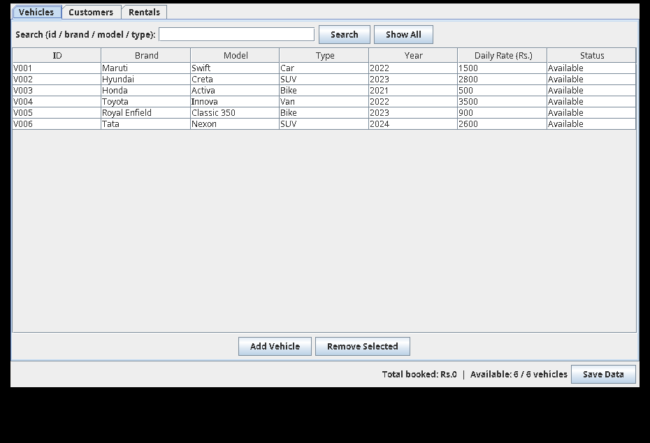

# Vehicle Rental Management System

A Java 17 desktop application (Swing, no external libraries) for managing
vehicle rentals: vehicles, customers, bookings and returns.

Project report: `docs/report/main.pdf` (11 pages, LaTeX source in
`docs/report/main.tex`). It is a Course End Project Report in the format
of the Employee Payroll template supplied by the user: VCE logo title
page, Contents, Abstract, Introduction, Literature Review, Objectives,
Methodology (Architectural Diagram, Requirements, Working Principle,
Software Implementation), Results and Discussion, Limitations, PO/SDG
mapping, Conclusion and Bibliography. The report's title page names
the sole student for this submission as A Vivek Reddy (25881A05EP),
course facilitator Mr. D. Ganesh (Assistant Professor), and course
Object Oriented Programming through Java Laboratory — the same
facilitator and course as in the supplied Employee Payroll template,
as instructed. No other team members are included.

## Features

- **Vehicles** — add, list, search (by id, brand, model or type, via the
  search bar on the Vehicles tab) and remove
  available vehicles. Each vehicle has an id, brand, model, type
  (Car / Bike / SUV / Van), year and daily rental rate.
- **Customers** — add and list customers with phone and driving licence number.
- **Rentals** — rent an available vehicle for a number of days.
  Cost is calculated exactly as `daily rate x days` (BigDecimal).
  A rented vehicle cannot be double-booked.
- **Returns** — return a rental, which frees the vehicle for the next booking.
- **Persistence** — data is saved to CSV files under `data/`
  (`vehicles.csv`, `customers.csv`, `rentals.csv`) and reloaded on launch.
  On first launch, 6 sample vehicles and 3 sample customers are seeded.

## Project structure

```
src/com/rental/
  Main.java                 Entry point (launches the Swing UI)
  model/
    Vehicle.java            Vehicle details + availability
    Customer.java           Customer details
    Rental.java             One booking: vehicle, customer, days, cost, status
  service/
    RentalService.java      Business rules: rent / return / search / totals
  persistence/
    CsvRentalStore.java     CSV save / load under data/
  ui/
    RentalApp.java          Swing UI: Vehicles / Customers / Rentals tabs
tests/com/rental/
  RentalServiceTest.java    Dependency-free tests for the service layer
docs/report/
  main.tex                  LaTeX report source (Overleaf-compatible)
  main.pdf                  Compiled report (11 pages)
  college_logo.jpg          VCE logo used on the report title page
  vehicle-main.png          Screenshot used in the report
screenshots/
  vehicle-main.png          Genuine screenshot of the running application
```

## Screenshot



Main window on first launch: Vehicles tab with the search bar, the six
seeded vehicles, and footer totals (Total booked: Rs. 0, Available: 6 / 6).

## Requirements

- JDK 17 or later (no other dependencies)

## Run

```sh
./compile.sh
./run.sh
```

Or manually:

```sh
javac --release 17 -d out $(find src -name '*.java')
java -cp out com.rental.Main
```

## Test

```sh
./test.sh
```

This compiles the service and runs `RentalServiceTest`, which checks
rental pricing, double-booking rejection, return freeing the vehicle,
search, duplicate-id rejection and removal rules.
